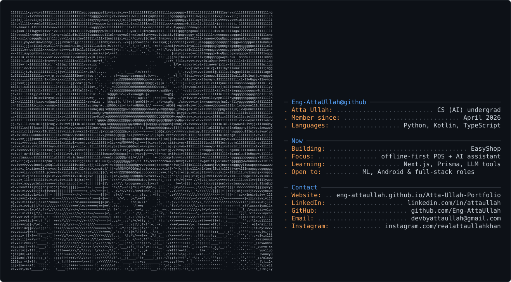

# Atta Ullah

**CS (AI) undergraduate · ML, Android & full-stack developer**

*Open to internships / junior roles in ML, Android, or full-stack*

---

## Now

**Nov 23, 2026** — building **[EasyShop](https://github.com/Eng-AttaUllah/EasyShop)**, an offline-first shop management app with a confirm-before-save AI assistant (Next.js · Prisma · SQLite). **[ZYR0](https://zyroo.org)** is live as an ecosystem of tools for building, learning, research, and internships.

Flagship FYP: **[AdVeto](https://github.com/Eng-AttaUllah/AdVeto)** — on-device ad detection and age-aware risk classification for Android.

---

## About Me

I'm **Atta Ullah**, a Computer Science (**Artificial Intelligence**) undergraduate at Abdul Wali Khan University Mardan. I build practical AI systems — from on-device Android classifiers and computer-vision surveillance to data-driven prediction models.

My stack spans **Python** (scikit-learn, Pandas, NumPy, OpenCV) on the AI/ML side, **Kotlin and Android** for mobile, and **TypeScript, React, and Tailwind CSS** on the web. I work with **Git and GitHub** every day.

**AdVeto** is my final-year flagship: detect ad regions on Android and classify age-aware risk on-device with a quantised multimodal model. Alongside that, I'm shipping **EasyShop** and polishing **ZYR0**.

**Turning raw data into predictions, and ideas into working projects.**

---

## Featured Projects

<table>
  <tr>
    <td width="50%" valign="top">
      <h3><a href="https://github.com/Eng-AttaUllah/AdVeto">AdVeto</a></h3>
      Final-year project: on-device ad-region detection and age-aware risk classification for Android (API 29–35). 
      Kotlin · Android · ML · OCR
    </td>
    <td width="50%" valign="top">
      <h3><a href="https://github.com/Eng-AttaUllah/EasyShop">EasyShop</a></h3>
      Offline-first shop / POS app with a confirm-before-save AI assistant — works without a constant cloud connection. 
      Next.js · Prisma · SQLite
    </td>
  </tr>
  <tr>
    <td width="50%" valign="top">
      <h3><a href="https://github.com/Eng-AttaUllah/Theft-Detection">Shop Theft Detection</a></h3>
      Offline CCTV pipeline that tracks people and flags suspicious behaviour in real time for small shops. 
      Python · OpenCV · ByteTrack
    </td>
    <td width="50%" valign="top">
      <h3><a href="https://github.com/Eng-AttaUllah/Spam-Detector-with-98--accuracy">SMS Spam Detector</a></h3>
      ~98% accuracy SMS spam classifier (TF-IDF + Logistic Regression), optional DistilBERT path, and a Streamlit demo. 
      Python · scikit-learn · Streamlit
    </td>
  </tr>
</table>

Also live: **[ZYR0](https://zyroo.org)** (internship platform) · **[Portfolio](https://eng-attaullah.github.io/Atta-Ullah-Portfolio/)**

---

## Tech Stack

  
  
  
  
  
  

---

## GitHub Stats

  
  

---

## Connect

  
  
  
  

