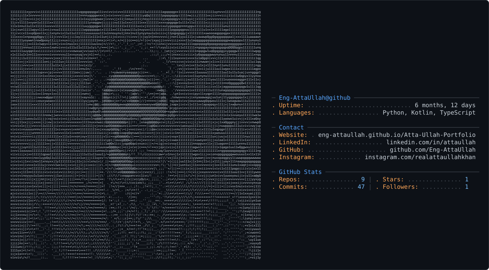

# Atta Ullah

---

## About Me

I'm **Atta Ullah**, a Computer Science (**Artificial Intelligence**) undergraduate at Abdul Wali Khan University Mardan, building practical AI systems — from on-device Android classifiers and computer-vision surveillance to data-driven prediction models.

My stack spans **Python, scikit-learn, Pandas, NumPy, and OpenCV** on the AI/ML side, **Kotlin and Android** for mobile, and **TypeScript, React, Vite, and Tailwind CSS** on the web. I work with **Git and GitHub** every day.

My current focus is **AdVeto** — our final-year project that detects ad regions on Android and classifies age-aware risk on-device with a quantised multimodal model.

**Turning raw data into predictions, and ideas into working projects.**

---

## Tech Stack

  
  
  
  
  
  
  

  
  
  
  
  
  

  
  
  

---

## 🚀 Featured Projects

<table>
  <tr>
    <td width="50%" valign="top">
      <h3>🛡️ <a href="https://github.com/Eng-AttaUllah/AdVeto">AdVeto</a></h3>
      On-device ad-region detection and age-aware risk classification for Android (API 29–35). 
      Kotlin · Android · ML · OCR
    </td>
    <td width="50%" valign="top">
      <h3>🎥 <a href="https://github.com/Eng-AttaUllah/Theft-Detection">Shop Theft Detection</a></h3>
      Offline CCTV surveillance that flags suspicious behaviour in real time. 
      Python · OpenCV · ByteTrack
    </td>
  </tr>
  <tr>
    <td width="50%" valign="top">
      <h3>📧 <a href="https://github.com/Eng-AttaUllah/Spam-Detector-with-98--accuracy">SMS Spam Detector</a></h3>
      TF-IDF + Logistic Regression classifier with an optional DistilBERT model and Streamlit app. 
      Python · scikit-learn · Streamlit
    </td>
    <td width="50%" valign="top">
      <h3>🌐 <a href="https://eng-attaullah.github.io/Atta-Ullah-Portfolio/">Portfolio</a></h3>
      Personal site and résumé, with content driven from data files. 
      React · TypeScript · Tailwind CSS
    </td>
  </tr>
</table>

---

## GitHub Stats

  
  

  

---

## Connect

  
  
  
  
  

---

  <i>"Turning raw data into predictions, and ideas into working projects ∞ ."</i>

  

