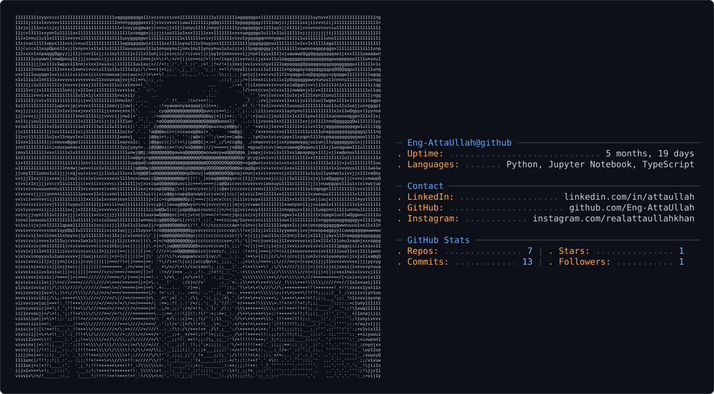

# Atta Ullah

---

## About Me

I’m **Atta Ullah**, an Artificial Intelligence undergraduate focused on machine learning, data-driven problem solving, and building practical AI projects.

My stack includes **Python, Jupyter, scikit-learn, Pandas, NumPy, and Matplotlib**, along with **Git and GitHub** for collaboration and version control.

I enjoy working with **datasets, models, and code** — turning raw data into predictions and ideas into working projects. Recently I’ve been building classifiers and prediction models, and I’m always exploring something new in AI.

**Currently exploring AI, one project at a time.**

---

## Tech Stack

  
  
  
  
  
  

  
  
  

---

## GitHub Stats

  
  

  

---

## Connect

  
  
  
  

---

  <i>"Exploring AI, one project at a time ∞ ."</i>

  

